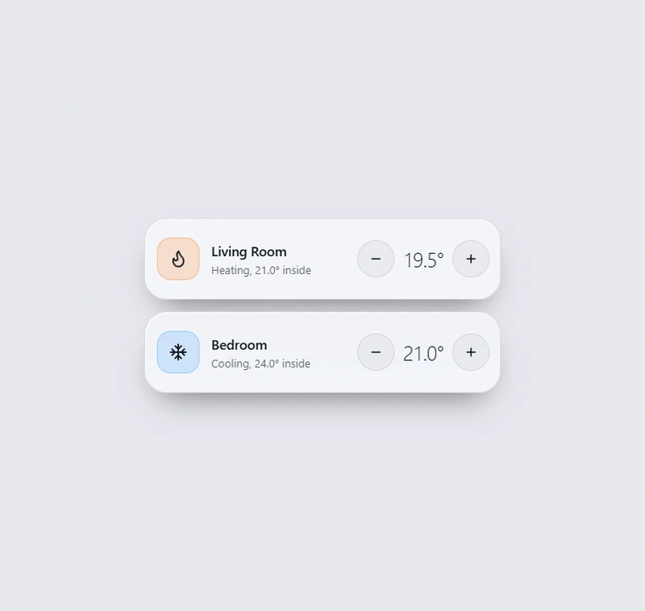
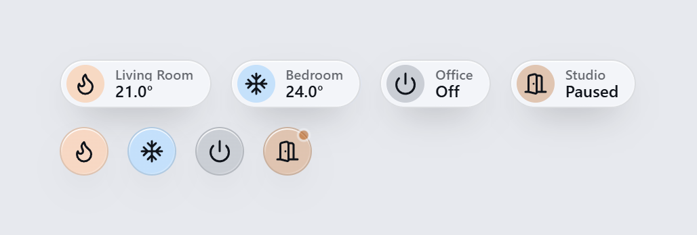
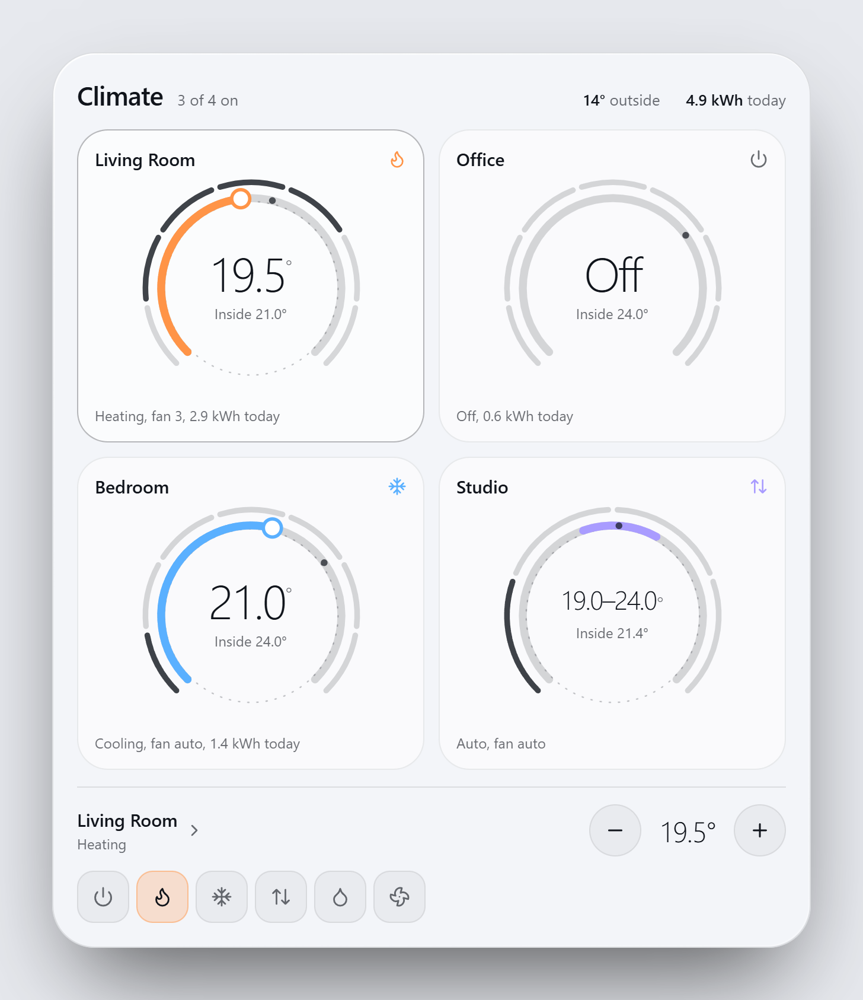
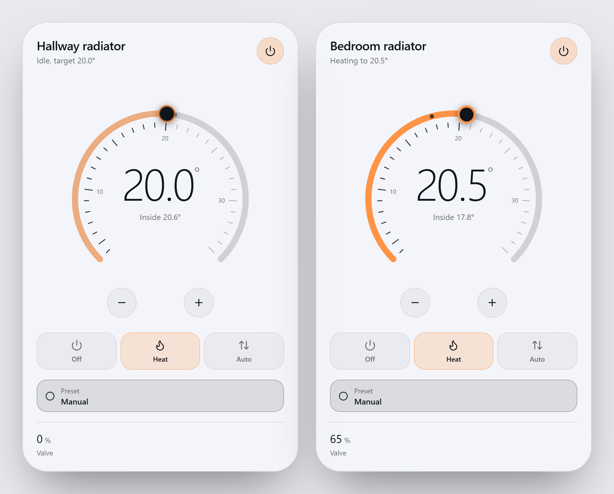
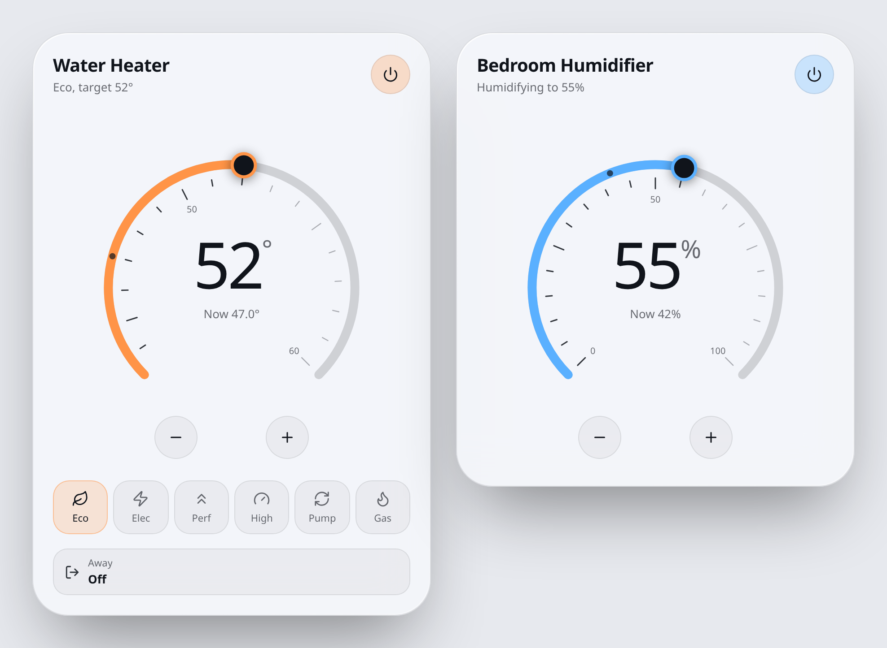
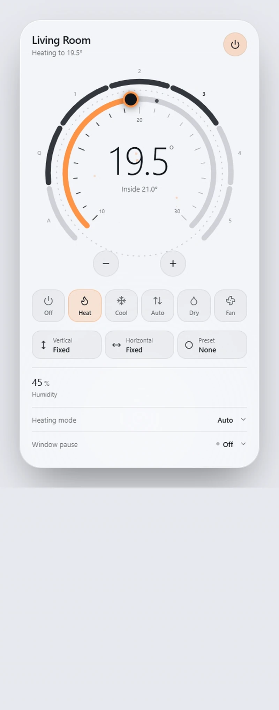
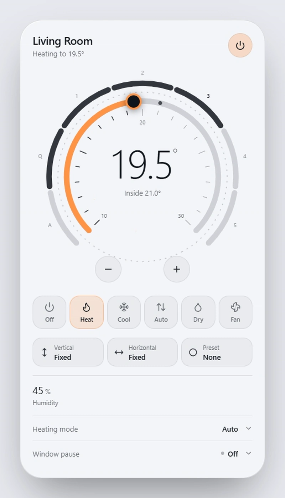

<div align="center">

<picture>
  <source media="(prefers-color-scheme: dark)" srcset="docs/public/media/hero-dark.png">
  <source media="(prefers-color-scheme: light)" srcset="docs/public/media/hero-light.png">
  
</picture>

# Liquid Climate

Glass cards for Home Assistant climate entities, water heaters and humidifiers: dial, tile, badge and cluster.

[](https://hacs.xyz)
[](LICENSE)
[](https://www.home-assistant.io)
[](https://github.com/decibel95/liquid-climate/releases)

</div>

A liquid glass look, any `climate`, `water_heater` or `humidifier` entity, a visual editor for every card. Controls the entity does not support are hidden. Light and dark follow your Home Assistant theme.

## Cards

### Dial

Full control for one unit. The inner ring sets the temperature, the outer segmented ring sets the fan speed. Dual setpoint entities get two knobs. Humidity, outdoor temperature, energy, cloud rate limit and unit health are found on the device automatically, including Daikin Onecta.

<table align="center">
  <tr>
    <td></td>
    <td></td>
  </tr>
</table>

### Tile

A compact row with a power button, status and target steppers. Tap the name and the dial opens as a sheet.

<div align="center">
  
</div>

### Badge

A status pill for view badges or a grid. Shows the room temperature, Off, Paused or Error. Also available as a round icon-only badge.

<div align="center">
  <picture>
    <source media="(prefers-color-scheme: dark)" srcset="docs/public/media/badge-dark.png">
    
  </picture>
</div>

### Cluster

Every unit in one card, grouped by floor or area. A header with a summary and shared figures, a mini dial per room, and a control strip for the selected room.

<div align="center">
  <picture>
    <source media="(prefers-color-scheme: dark)" srcset="docs/public/media/cluster-dark.png">
    
  </picture>
</div>

### Radiator valves

Radiator valves (Zigbee2MQTT, Better Thermostat, generic thermostat) work on all four cards. An idle valve reads Idle, the valve opening shows as a figure, a low battery raises an alert and an open window pauses the badge and the cluster room.

<div align="center">
  <picture>
    <source media="(prefers-color-scheme: dark)" srcset="docs/public/media/trv-dark.png">
    
  </picture>
</div>

### Water heaters and humidifiers

A `water_heater` gets the temperature arc, its operation modes (Eco, Electric, Heat pump and so on) as buttons, power and an Away chip when it supports them. A `humidifier` gets the target humidity in %, the current humidity in the centre, its modes when it has them, and power. They use the same colours as heat, cool and dry. There is no fan ring for either. The tile and badge show the same figures. In a cluster they are opt-in through `domains`, so an existing cluster does not change.

<div align="center">
  <picture>
    <source media="(prefers-color-scheme: dark)" srcset="docs/public/media/appliances-dark.png">
    
  </picture>
</div>

### Also included

- **Status rows and menu.** Add rows under the dial for helpers, scripts and automations. Rows for `input_select`, `select`, `input_boolean` and `switch` open an inline menu to change the value.

  

- **Copy diagnostics.** The editor footer copies a report for bug reports.
- **Six languages.** English, Dutch, German, French, Spanish and Italian.
- **Few service calls.** Changes are collected for 1.5 seconds and sent as the minimum number of calls, so one drag is one call. Kind to cloud integrations with a daily call limit.

## Quick start

<!-- ha-marketplace:exclude-start -->
[](https://my.home-assistant.io/redirect/hacs_repository/?owner=decibel95&repository=liquid-climate&category=plugin)

**Home Assistant 2026.11 and newer (built-in Marketplace):**

1. Open Settings, Marketplace and search for **Liquid Climate** (or use the button above).
2. Install it. The dashboard resource is added for you.
3. Reload the browser (clear the cache if the card does not appear).

**Older Home Assistant with HACS:**

1. Open HACS and search for **Liquid Climate**.
2. Download it and reload the browser. HACS adds the resource for you.

**Not found in the search?** Add it by link as a custom repository: `https://github.com/decibel95/liquid-climate`, category **Dashboard**. In the Marketplace use the menu, **Add from link** (needs a connected GitHub account). In HACS use the menu (three dots), **Custom repositories**.

**Manual install instead:** download `liquid-climate.js` from the latest release (or build it: `npm run build` writes `dist/liquid-climate.js`) and copy it to `/config/www/`. Then Settings, Dashboards, Resources: add `/local/liquid-climate.js` as a **JavaScript module** and hard refresh.
<!-- ha-marketplace:exclude-end -->

**Add a card.** Edit a dashboard, add a card, pick **Liquid Climate** (or the tile, badge or cluster) and choose your climate, water heater or humidifier entity.

## YAML examples

Only `entity` is required on the dial, tile and badge. The cluster needs nothing.

```yaml
type: custom:liquid-climate-card
entity: climate.living_room
name: Living Room
```

```yaml
type: custom:liquid-climate-tile
entity: climate.bedroom
tap_action: more-info
```

```yaml
# In the view badges
badges:
  - type: custom:liquid-climate-badge
    entity: climate.living_room
    pause_entity: binary_sensor.living_room_window
```

```yaml
# Every climate entity, grouped by floor
type: custom:liquid-climate-cluster
title: Climate
exclude:
  - climate.guest_room
```

```yaml
# A water heater and a humidifier
type: custom:liquid-climate-card
entity: water_heater.boiler
```

```yaml
type: custom:liquid-climate-tile
entity: humidifier.bedroom
```

```yaml
# Water heaters and humidifiers join a cluster only when asked
type: custom:liquid-climate-cluster
domains: [climate, water_heater, humidifier]
```

All options are in the [dial](https://decibel95.github.io/liquid-climate/cards/dial#dial-options), [tile](https://decibel95.github.io/liquid-climate/cards/tile), [badge](https://decibel95.github.io/liquid-climate/cards/badge) and [cluster](https://decibel95.github.io/liquid-climate/cards/cluster) docs.

## Languages

`en`, `nl`, `de`, `fr`, `es`, `it`. The cards follow your Home Assistant profile language. Dutch is reviewed, the others are machine translated and PRs are welcome. See [CONTRIBUTING-translations.md](CONTRIBUTING-translations.md).

<div align="center">
  
</div>

## Documentation

| Page | Covers |
|------|--------|
| [Getting started](https://decibel95.github.io/liquid-climate/getting-started) | Install, first card |
| [Dial](https://decibel95.github.io/liquid-climate/cards/dial) | Options and config reference |
| [Tile](https://decibel95.github.io/liquid-climate/cards/tile) | Options |
| [Badge](https://decibel95.github.io/liquid-climate/cards/badge) | Options |
| [Cluster](https://decibel95.github.io/liquid-climate/cards/cluster) | Rooms, grouping, options |
| [Status rows and menu](https://decibel95.github.io/liquid-climate/status-rows) | Helpers, scripts, automations |
| [Sensor detection](https://decibel95.github.io/liquid-climate/sensors) | How sensors are found |
| [Theming](https://decibel95.github.io/liquid-climate/theming) | Glass, tint, blur, CSS variables |
| [Languages](https://decibel95.github.io/liquid-climate/languages) | Translations |
| [Troubleshooting](https://decibel95.github.io/liquid-climate/troubleshooting) | Common problems, Copy diagnostics |

## Contributing

Translations are welcome, see [CONTRIBUTING-translations.md](CONTRIBUTING-translations.md). For bugs, see [Troubleshooting](https://decibel95.github.io/liquid-climate/troubleshooting#report-a-bug). For development: `npm install`, then `npm run dev`, `npm test`, `npm run typecheck` and `npm run build`.

## License

[MIT](LICENSE)
