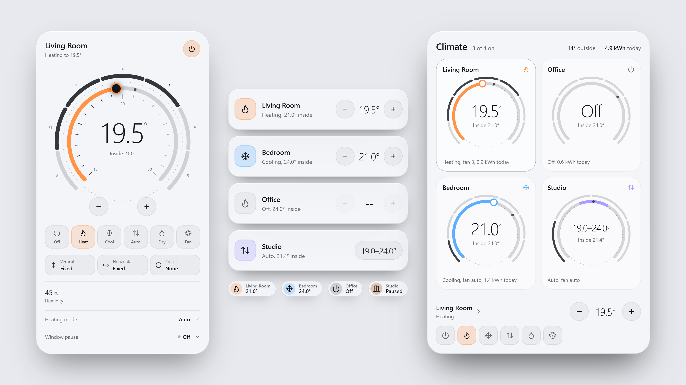

# Liquid Climate

Liquid glass climate cards for Home Assistant: dial, tile, badge and cluster. They work with `climate`, `water_heater` and `humidifier` entities.

<picture>
  <source media="(prefers-color-scheme: light)" srcset="https://raw.githubusercontent.com/decibel95/liquid-climate/main/docs/public/media/hero-light.png">
  <source media="(prefers-color-scheme: dark)" srcset="https://raw.githubusercontent.com/decibel95/liquid-climate/main/docs/public/media/hero-dark.png">
  
</picture>

<sub>Dial, tile, badge and cluster on light glass; dark glass in dark mode.</sub>

Requires Home Assistant 2025.1 or newer.

<!-- ha-marketplace:exclude-start -->
## Install

[](https://my.home-assistant.io/redirect/hacs_repository/?owner=decibel95&repository=liquid-climate&category=plugin)

**Home Assistant Marketplace (2026.11 and newer).** Open Settings, Marketplace, search for **Liquid Climate** and install it. The dashboard resource is added for you.

**HACS (older versions).** Search for **Liquid Climate** in HACS, download it and reload the browser. If the search does not find it, add `https://github.com/decibel95/liquid-climate` as a custom repository (category Dashboard).

**Manual.** Download `liquid-climate.js`, `liquid-inter.woff2` and `liquid-inter-OFL.txt` from the [latest release](https://github.com/decibel95/liquid-climate/releases/latest) and copy them to `/config/www/`. Then add `/local/liquid-climate.js` as a **JavaScript module** under Settings, Dashboards, Resources, and hard refresh. If the card does not update, see [Troubleshooting](https://decibel95.github.io/liquid-climate/troubleshooting).
<!-- ha-marketplace:exclude-end -->

## Use

Edit a dashboard, add a card and pick **Liquid Climate**. Or use YAML:

```yaml
type: custom:liquid-climate-card
entity: climate.living_room
```

## Documentation

All options, device detection, theming, languages and troubleshooting: [decibel95.github.io/liquid-climate](https://decibel95.github.io/liquid-climate/).

## On the roadmap

What we are working on. Plans can change.

- Device icons for climate devices.
- History on the card faces.
- Moving fully onto the shared liquid-core design library, so all Liquid cards look and feel the same (planned).

Missing something? Feature requests and ideas are welcome: [open an issue](https://github.com/decibel95/liquid-climate/issues/new/choose).

## Liquid family

<!-- When a new Liquid repo is created, add its row to this table in every Liquid README. -->

| Project | What it is |
| --- | --- |
| **Liquid Climate** (this repo) | Glass cards for climate, water heater and humidifier entities (Home Assistant, HACS) |
| [Liquid Home](https://github.com/decibel95/liquid-home) | Glass cards for lights, covers and fans; media player next (Home Assistant, HACS) |
| [liquid-core](https://github.com/decibel95/liquid-core) | Shared design library behind the Liquid cards (npm) |

## License

[MIT](LICENSE). The Liquid Inter font is under the SIL Open Font License 1.1 and the Lucide icons under ISC, see [NOTICE](NOTICE).
